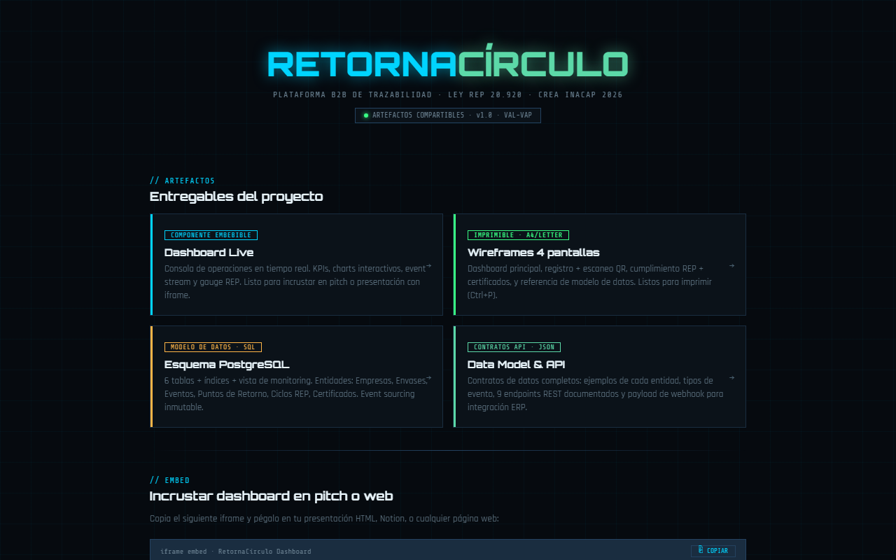

# ♻ RetornaCírculo

[](https://github.com/Fernandamv96/retornacirculo-saas/actions/workflows/ci.yml)
[](LICENSE)

> Plataforma SaaS B2B de trazabilidad digital para la gestión de retorno y valorización de envases industriales en Chile.

**Ley REP 20.920 · DS N°12/2020 · Región de Valparaíso · CREA INACAP 2026**

---

## ¿Qué es RetornaCírculo?

RetornaCírculo permite a empresas productoras e importadoras gestionar, registrar y **certificar el retorno de sus envases** en cumplimiento con la Ley de Responsabilidad Extendida del Productor (Ley REP), eliminando el riesgo de multas de hasta **10.000 UTA** por incumplimiento ante la Superintendencia del Medio Ambiente.

Cada envase recibe un **código QR único** que lo identifica durante todo su ciclo de vida. Cada retorno, despacho o valorización queda registrado de forma **inmutable y trazable**, generando automáticamente los reportes exigidos por el Ministerio del Medio Ambiente en formato RETC-JSON-v2.

---

## Demo en vivo

| Recurso | URL |
|---|---|
| 🖥️ Hub principal | [retornacirculo.vercel.app](https://retornacirculo.vercel.app) |
| 📊 Dashboard live | [retornacirculo.vercel.app/dashboard.html](https://retornacirculo.vercel.app/dashboard.html) |
| 🖨️ Wireframes imprimibles | [retornacirculo.vercel.app/wireframes.html](https://retornacirculo.vercel.app/wireframes.html) |

---



## Estado actual del prototipo

> **Prototipo académico.** Las características de abajo describen la **propuesta de producto**. Lo que hoy funciona en este repo:
>
> - Hub, dashboard (datos simulados) y wireframes navegables.
> - `registro.html` **lee** empresas y envases desde Supabase con la clave pública (*publishable*).
> - El **registro** de envases y eventos llama a `/api/envases` y `/api/eventos`, que **no están en este repo** (hoy responden 404). Certificados, exportación RETC, webhooks y modo offline están **diseñados** (`schema.sql`, `data-model.json`), no implementados.

## Características principales

- **Trazabilidad QR** — identidad digital única por envase, historial inmutable con event sourcing
- **Dashboard en tiempo real** — KPIs de retorno, cumplimiento REP por material y stream de eventos
- **Certificados digitales** — folio único con hash SHA-256, verificables en línea ante la SMA
- **Exportación RETC automática** — payload RETC-JSON-v2 listo para el Ministerio del Medio Ambiente
- **API REST abierta** — 9 endpoints documentados con webhooks HMAC para integración con ERPs
- **Offline-first** — operación sin internet en puntos de retorno remotos

---

## Archivos del repositorio

```
retornacirculo/
├── index.html          # Hub central de artefactos + embed code
├── dashboard.html      # Dashboard interactivo embebible (Chart.js)
├── wireframes.html     # 4 pantallas imprimibles A4
├── schema.sql          # Esquema PostgreSQL completo (6 tablas)
└── data-model.json     # Contratos de API REST + ejemplos de payload
```

---

## Modelo de datos

```
empresas ──< envases ──< eventos
               │
puntos_retorno ┘
ciclos_rep ──< certificados
```

6 entidades · Event sourcing inmutable · Columnas calculadas (tasa_real_pct, en_meta) · Vista v_dashboard

---

## Stack tecnológico

| Capa | Tecnología |
|---|---|
| Frontend | React + Chart.js + Tailwind |
| Backend | Node.js + Express (REST) |
| Base de datos | PostgreSQL |
| Despliegue | Vercel / Railway |
| Autenticación | JWT con rotación 24h |
| Webhooks | HMAC-SHA256 |

---

## Incrustar el dashboard

```html
<iframe
  src="https://retornacirculo.vercel.app/dashboard.html"
  width="900"
  height="560"
  style="border:none;border-radius:4px;"
  title="RetornaCírculo · Dashboard"
></iframe>
```

---

## Equipo

Proyecto CREA · Innovación y Emprendimiento I  
**INACAP Valparaíso · Ingeniería en Telecomunicaciones, Conectividad y Redes · 2026**

Amaro Tapia · Daniela Muñoz · Julio Anabalón · Vicente Rodríguez · Diego Baxter · Diego Maturana

---

## Marco regulatorio

- 🇨🇱 Ley REP 20.920 — Responsabilidad Extendida del Productor
- 📋 DS N°12/2020 — Reglamento de envases y embalajes
- 🏛️ RETC — Registro de Emisiones y Transferencia de Contaminantes (MMA)
- ⚖️ SMA — Superintendencia del Medio Ambiente

---

*RetornaCírculo · 2026 · Valparaíso, Chile*

## 🔒 Calidad y seguridad

- CI en cada push y PR: `html-validate`, además de CodeQL, Dependabot y gitleaks en pre-commit.
- Para reportar vulnerabilidades, mira [SECURITY.md](SECURITY.md).

> La clave de Supabase en `registro.html` es la *publishable key* (pensada para el navegador). La seguridad de los datos depende de tener **Row Level Security** activo en todas las tablas.

## Qué aprendí

- A modelar trazabilidad con *event sourcing* (eventos inmutables por envase).
- A diseñar contratos de API antes de implementarlos.
- Que una clave pública de Supabase es segura solo si las políticas RLS lo son.

## 📄 Licencia

[MIT](LICENSE) © 2026 Fernanda (Fernandamv96)
